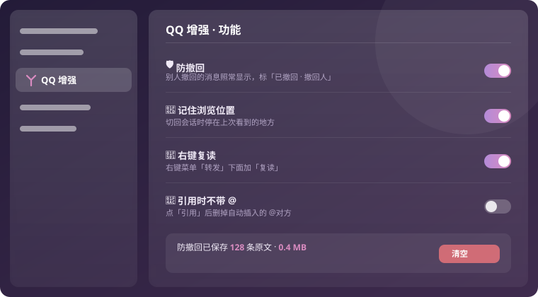
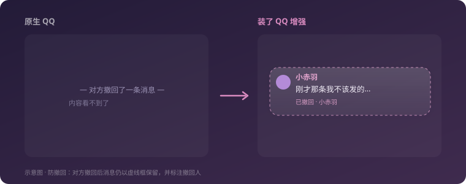

<div align="center">

# ⚡ QQ 增强 · qq-enhance

**QQNT 功能插件合集：防撤回 · 记住浏览位置 · 右键复读 · 引用不带 @**

[](https://github.com/LiteLoaderQQNT/LiteLoaderQQNT)
[](https://im.qq.com/)
[](#)
[](#)


</div>

---

> 功能性改动的合集。外观相关的（主题、Markdown、@ 高亮、名字颜色、入场动画）在姊妹插件 **[琉璃 Liuli · qqnt-liuli-theme](https://github.com/LilycleHeart/qqnt-liuli-theme)** 里。
>
> 设置：QQ 设置左栏「**QQ 增强**」，每项单独开关，改了立刻生效。

## 📸 预览

<div align="center">

<!-- SCREENSHOTS -->


<br/><br/>



<br/>
<sub>示意图，非实机截图</sub>

</div>

## ✨ 功能

| | 功能 | 说明 |
|---|---|---|
| 🛡️ | **防撤回** | 别人撤回的消息照常显示，标「已撤回 · 撤回人」。自己用管理员身份撤回别人的也保留；自己撤回自己的不管（保留「重新编辑」）。移植自 BetterQQNT 的 AntiRecallPlugin |
| 📍 | **记住浏览位置** | 切回会话时停在上次看到的地方（Telegram 的做法）；上次在底部就留在底部 |
| 🔁 | **右键复读** | 消息右键菜单「转发」下面加「复读」，调内核 `forwardMsgWithComment` 原样转发回当前会话 |
| 💬 | **引用时不带 @** | 点「引用」后删掉 QQ 自动插入的 `@对方` |
| 🖼️ | **本地表情包** | 并进 QQ 自带的表情面板：底部分类栏「我的收藏」后面多一个「本地表情」。表情文件夹里每个子文件夹是一个分组，另有独立的收藏分组（星标或右键收藏）。点一下直接发送，Ctrl/Shift + 点击发完不收起面板 |

## 📦 安装

### 第一步：装好 LiteLoaderQQNT

本插件是标准 [**LiteLoaderQQNT**](https://github.com/LiteLoaderQQNT/LiteLoaderQQNT) 插件，需要 QQ 先加载 LiteLoader。

最省事的办法是用姊妹仓库的**一键安装器**：到 [琉璃 Releases](https://github.com/LilycleHeart/qqnt-liuli-theme/releases/latest) 下载 `QQNT-LiteLoader-Installer.exe`，双击点「一键安装」，它会装好 LiteLoader（含文件校验补丁）。

> 手动安装见 [LiteLoaderQQNT 官方文档](https://liteloaderqqnt.github.io/guide/install.html)：QQ 9.9.x 会校验自身文件，需用 `dbghelp_x64.dll`（改名 `dbghelp.dll`）+ 补丁版 `QQ.exe` 放进 QQ 安装目录绕过（先备份原文件）。

### 第二步：装插件

1. 把本仓库放到 `LiteLoaderQQNT\plugins\qq-enhance\`
2. 重启 QQ
3. QQ 设置左栏找到「**QQ 增强**」，按需开关各功能

> 一键安装器只装 LiteLoader + 琉璃主题，不含本插件，所以本插件需按上面手动放入。

## 🗄️ 数据

`%APPDATA%\LiteLoaderQQNT\data\qq-enhance\`

| 文件 | 内容 |
|---|---|
| `config.json` | 各功能开关、表情文件夹位置 |
| `stickers\` | 默认的表情文件夹（设置页可换成别的文件夹） |
| `sticker-favs.json` | 本地表情的收藏 |
| `anti-recall\messages\<msgId>.json` | 被撤回消息的原文 |
| `anti-recall\recalled.json` | 撤回列表（重启后仍有标记） |
| `plugin.log` | 日志 |

第一次启动会从旧的独立 `anti-recall` 插件目录搬一次数据。

## 🔬 实测依据（QQ 9.9.36）

- 内核消息下行：`webContents.send("RM_IPCFROM_MAIN…", meta, {cmdName, payload})`
- 内核调用上行：`RM_IPCFROM_RENDERER<id>`，`{type:"request", callbackId, eventName:"ntApi", peerId}` + `{cmdName, cmdType:"invoke", payload:[arg, null]}`
- 消息数据：`.message` 元素的 `__VUE__[0].props.msgRecord`
- 输入框里引用插入的 @：`<span class="editor-el__at" contenteditable="false">`
- 撤回字段：`revokeElement.isSelfOperate / operatorUid / origMsgSenderUid`

## 🧪 测试

```powershell
node test/anti-recall.test.cjs
```

---

<div align="center">
<sub>基于 <a href="https://github.com/LiteLoaderQQNT/LiteLoaderQQNT">LiteLoaderQQNT</a> · 部分移植自 BetterQQNT</sub>
</div>
